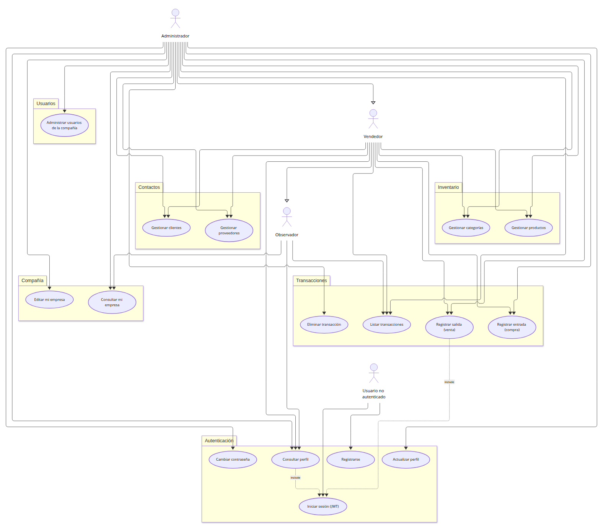
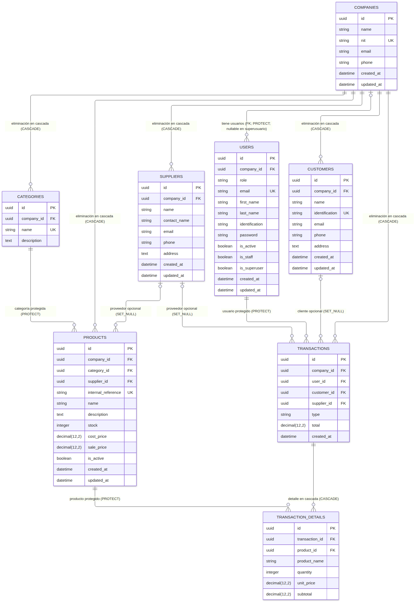
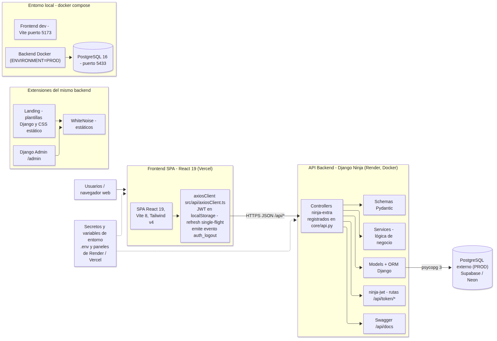

# Manual técnico — Sistema de Inventario SaaS para PyMEs

El presente documento constituye el manual técnico del Sistema de Inventario SaaS para PyMEs, una solución web de gestión de inventario multiempresa desarrollada como proyecto formativo SENA. Describe los prerrequisitos de instalación, los frameworks y estándares empleados, los diagramas de casos de uso, el modelo entidad-relación de la base de datos, el diccionario de datos, los scripts de instalación y el diagrama de componentes del sistema. Toda la información aquí consignada corresponde a la implementación real verificada en el repositorio del proyecto.

## 1. Prerrequisitos de instalación del sistema

El sistema se compone de dos aplicaciones independientes alojadas en un mismo repositorio: un backend tipo API (Django) y un frontend SPA (React), sin manifiesto ni herramientas compartidas a nivel de raíz. Los prerrequisitos se agrupan por componente.

### 1.1 Backend (API Django)

| Requisito | Detalle |
| --- | --- |
| Lenguaje | Python 3.12 |
| Herramientas | `pip` y `venv` (incluidos en la distribución de Python), Git |
| Base de datos DEV | SQLite (archivo `db.sqlite3`); no requiere instalación adicional. Se selecciona con `ENVIRONMENT=DEV` (valor por defecto) |
| Base de datos PROD | PostgreSQL (por ejemplo, Supabase o Neon), con driver `psycopg` v3. Se selecciona con `ENVIRONMENT=PROD`, que lee la cadena de conexión de la variable `DATABASE_URL` |
| Configuración | Archivo `backend/.env` creado a partir de `backend/.env.example` (procesado por `django-environ`) |

### 1.2 Frontend (SPA React)

| Requisito | Detalle |
| --- | --- |
| Runtime | Node.js versión 20 o superior (el proyecto fue verificado con Node 24) |
| Gestor de paquetes | `pnpm` (disponible a través de `corepack`) |
| Control de versiones | Git |
| Variable de entorno | `VITE_API_URL` con la URL base de la API (ver `frontend/.env.example`), consumida por `src/api/axiosClient.ts` |

### 1.3 Despliegue

| Requisito | Detalle |
| --- | --- |
| Backend | Cuenta en Render para desplegar el web service Docker (plan free), usando el blueprint `render.yaml` |
| Frontend | Cuenta en Vercel para el despliegue de la SPA estática |
| Base de datos PROD | Instancia PostgreSQL del proveedor elegido (Supabase, Neon u otro) |
| Configuración | Variables de entorno del backend: `ENVIRONMENT`, `DEBUG`, `SECRET_KEY`, `DATABASE_URL`, `ALLOWED_HOSTS`, `CORS_ALLOWED_ORIGINS`, `LANDING_*`. Del frontend: `VITE_API_URL` |

Nota: la selección de base de datos no es una verificación en tiempo de arranque; si se configura `ENVIRONMENT=PROD` sin una `DATABASE_URL` alcanzable, el servidor fallará al iniciar.

## 2. Frameworks y estándares con los que se construyó el sistema

### 2.1 Backend

| Tecnología | Versión | Uso |
| --- | --- | --- |
| Python | 3.12 | Lenguaje de programación del backend |
| Django | 6.0.6 | Framework web; `AUTH_USER_MODEL='accounts.User'` (usuario personalizado con correo único y PK UUID) |
| django-ninja | 1.6.2 | Definición de la API REST |
| django-ninja-extra | 0.31.5 | Controllers `@api_controller` registrados explícitamente en `core/api.py` |
| django-ninja-jwt | 5.4.4 | Autenticación JWT (`JWTAuth()` por ruta); rutas `/api/token/pair`, `/api/token/refresh` y `/api/token/verify` |
| Pydantic | 2.13.4 | Schemas de validación y serialización |
| psycopg | 3.3.4 | Driver de PostgreSQL para el entorno PROD |
| gunicorn | 26.0.0 | Servidor WSGI de producción |
| whitenoise | 6.12.0 | Servido de estáticos (middleware + STORAGES manifest) |
| django-cors-headers | 4.9.0 | Control de CORS |
| django-environ | 0.13.0 | Lectura de variables de entorno desde `backend/.env` |
| pytest / pytest-django | 9.1.0 / 4.12.0 | Pruebas automatizadas (config en `backend/pytest.ini`) |

No se utiliza Django REST Framework.

### 2.2 Frontend

| Tecnología | Versión | Uso |
| --- | --- | --- |
| React / React DOM | ^19.2.6 | Biblioteca de interfaz de usuario |
| TypeScript | ~6.0.2 | Tipado estático |
| Vite | ^8.0.12 | Servidor de desarrollo y empaquetado |
| pnpm | lockfile `pnpm-lock.yaml` | Gestor de paquetes |
| Tailwind CSS | ^4.3.0 (`@tailwindcss/vite`) | Estilos utilitarios |
| React Router | ^7.17.0 (`react-router-dom`) | Enrutamiento de la SPA |
| axios | ^1.17.0 | Cliente HTTP; maneja JWT en `localStorage` y refresco *single-flight* en `src/api/axiosClient.ts`, emitiendo el evento `auth_logout` ante fallos de autenticación |
| lucide-react | ^1.17.0 | Iconografía |

### 2.3 Estándares empleados

- API REST sobre HTTP; todas las rutas viven bajo el prefijo `/api/`, con documentación Swagger en `/api/docs`.
- Autenticación JWT Bearer por ruta (`JWTAuth()`), con tokens emitidos por `ninja-jwt`.
- Claves primarias UUID en todos los modelos; migraciones gestionadas por Django.
- Multi-arrendamiento (multi-tenancy) manual: cada modelo dependiente posee la clave foránea `company` y todo listado/creación/consulta filtra por `request.user.company` en los controllers.
- Arquitectura por capas por aplicación Django: `models.py` + `schemas.py` (Pydantic) + `service.py` (lógica de negocio) + `controller.py` + `tests.py`.
- Localización `es-co` y mensajes de error del API en español (lanzados como `HttpError(400/409, ...)`).
- Estilo: PEP 8 con `ruff` en el backend (binario disponible en el venv, sin gate de CI configurado); ESLint (`pnpm lint`) y TypeScript (`pnpm build` → `tsc -b && vite build`) en el frontend.

## 3. Diagrama de casos de uso del sistema

El sistema expone los siguientes actores:

| Actor | Alcance |
| --- | --- |
| Usuario no autenticado | Registrarse (crea compañía y administrador) e iniciar sesión |
| Administrador (ADMIN) | Todas las operaciones: compañía, usuarios, inventario, contactos y transacciones |
| Vendedor (SELLER) | Gestión de inventario (categorías y productos), contactos y registro de transacciones |
| Observador (VIEWER) | Únicamente consulta (perfil, empresa, listado de transacciones) |

Los casos de uso se agrupan por sistema: Autenticación, Compañía, Inventario, Contactos, Transacciones y Usuarios. El caso de uso "Iniciar sesión (JWT)" es incluido por los casos de uso autenticados (relación `include`).



*Fuente editable del diagrama: `docs/diagramas/casos-de-uso.mmd` (Mermaid `usecase-beta`, sintaxis vigente de Mermaid 12).*

Nota: la jerarquía de permisos se modela con generalización: el Vendedor hereda del Observador y el Administrador resulta de la generalización del Vendedor, de modo que los niveles superiores acumulan los permisos de consulta y operación de los inferiores.

## 4. Modelo entidad relación de la base de datos

La base de datos está compuesta por 8 tablas: `companies`, `users`, `categories`, `products`, `suppliers`, `customers`, `transactions` y `transaction_details`. Todas las tablas usan PK de tipo UUID con valor generado por `uuid4`. Siete de ellas dependen de `companies` mediante la clave foránea `company`, lo que materializa el aislamiento multiempresa. El registro `users.password` no se declara en el modelo (lo aporta `AbstractBaseUser`); tiene una entrada en el diagrama y en el diccionario para completitud.



*Fuente editable del diagrama: `docs/diagramas/modelo-er.mmd`.*

Nota: los marcadores `UK` individuales del diagrama aproximan las restricciones compuestas definidas realmente en los modelos: `categories` es único por pares `(company, name)`; `products` por `(company, internal_reference)` mediante la restricción `unique_company_internal_reference`; `customers` por `(company, identification)`. Las restricciones de borrado (`ON DELETE`) se indican en las etiquetas de las relaciones: `PROTECT` impide eliminar registros referenciados, `SET_NULL` anula la clave foránea y `CASCADE` elimina en cascada los dependientes.

## 5. Diccionario de datos

Convenciones: Tipo indica el campo Django (longitud o precisión entre paréntesis); PK/Sí se marca en el campo `id` de cada tabla; FK indica la tabla y columna de destino; DateTimes con `auto_now_add` / `auto_now` se completan automáticamente y no admiten valor manual.

### 5.1 companies (tabla `companies`)

| Campo | Tipo | PK | FK | Null | Único | Default | Descripción |
| --- | --- | --- | --- | --- | --- | --- | --- |
| id | UUIDField | Sí | — | No | Sí | uuid4 | Identificador único de la compañía |
| name | CharField(255) | No | — | No | No | — | Nombre o razón social |
| nit | CharField(50) | No | — | No | Sí | — | NIT de la compañía, único a nivel global |
| email | EmailField | No | — | No | No | — | Correo de contacto |
| phone | CharField(50) | No | — | No | No | — | Teléfono de contacto |
| created_at | DateTimeField | No | — | No | No | auto_now_add | Fecha de creación |
| updated_at | DateTimeField | No | — | No | No | auto_now | Fecha de última modificación |

### 5.2 users (tabla `users`)

| Campo | Tipo | PK | FK | Null | Único | Default | Descripción |
| --- | --- | --- | --- | --- | --- | --- | --- |
| id | UUIDField | Sí | — | No | Sí | uuid4 | Identificador único del usuario |
| company | ForeignKey | No | companies.id | Sí | No | — | Compañía del usuario; `ON DELETE=PROTECT`; nulo para superusuarios (`null=True, blank=True`) |
| role | CharField(20) | No | — | No | No | VIEWER | Rol: `ADMIN`, `SELLER` o `VIEWER` |
| email | EmailField | No | — | No | Sí | — | Correo único; `USERNAME_FIELD` para autenticación |
| first_name | CharField(150) | No | — | No | No | — | Nombres |
| last_name | CharField(150) | No | — | No | No | — | Apellidos |
| identification | CharField(50) | No | — | No | No | — | Documento de identidad |
| password | Heredado de AbstractBaseUser | No | — | No | No | — | Hash de la contraseña (se almacena internamente) |
| is_active | BooleanField | No | — | No | No | True | Indica si la cuenta está activa |
| is_staff | BooleanField | No | — | No | No | False | Permite acceso al admin de Django |
| is_superuser | BooleanField (PermissionsMixin) | No | — | No | No | False | Marca de superusuario |
| created_at | DateTimeField | No | — | No | No | auto_now_add | Fecha de creación |
| updated_at | DateTimeField | No | — | No | No | auto_now | Fecha de última modificación |

### 5.3 categories (tabla `categories`)

| Campo | Tipo | PK | FK | Null | Único | Default | Descripción |
| --- | --- | --- | --- | --- | --- | --- | --- |
| id | UUIDField | Sí | — | No | Sí | uuid4 | Identificador único de la categoría |
| company | ForeignKey | No | companies.id | No | No | — | Compañía propietaria; `ON DELETE=CASCADE` |
| name | CharField(100) | No | — | No | Sí (con company) | — | Nombre de la categoría, único por compañía |
| description | TextField | No | — | Sí | No | — | Descripción opcional |

### 5.4 products (tabla `products`)

| Campo | Tipo | PK | FK | Null | Único | Default | Descripción |
| --- | --- | --- | --- | --- | --- | --- | --- |
| id | UUIDField | Sí | — | No | Sí | uuid4 | Identificador único del producto |
| company | ForeignKey | No | companies.id | No | No | — | Compañía propietaria; `ON DELETE=CASCADE` |
| category | ForeignKey | No | categories.id | No | No | — | Categoría del producto; `ON DELETE=PROTECT` |
| supplier | ForeignKey | No | suppliers.id | Sí | No | — | Proveedor; `ON DELETE=SET_NULL`; nulo y opcional |
| internal_reference | CharField(100) | No | — | No | Sí (con company) | — | Referencia interna del producto, única por compañía (restricción `unique_company_internal_reference`) |
| name | CharField(255) | No | — | No | No | — | Nombre del producto |
| description | TextField | No | — | Sí | No | — | Descripción opcional |
| stock | IntegerField | No | — | No | No | 0 | Cantidad disponible en inventario |
| cost_price | DecimalField(12,2) | No | — | No | No | — | Precio de costo |
| sale_price | DecimalField(12,2) | No | — | No | No | — | Precio de venta |
| is_active | BooleanField | No | — | No | No | True | Indica si el producto está activo |
| created_at | DateTimeField | No | — | No | No | auto_now_add | Fecha de creación |
| updated_at | DateTimeField | No | — | No | No | auto_now | Fecha de última modificación |

### 5.5 suppliers (tabla `suppliers`)

| Campo | Tipo | PK | FK | Null | Único | Default | Descripción |
| --- | --- | --- | --- | --- | --- | --- | --- |
| id | UUIDField | Sí | — | No | Sí | uuid4 | Identificador único del proveedor |
| company | ForeignKey | No | companies.id | No | No | — | Compañía propietaria; `ON DELETE=CASCADE` |
| name | CharField(255) | No | — | No | No | — | Nombre del proveedor |
| contact_name | CharField(255) | No | — | Sí | No | — | Persona de contacto (opcional) |
| email | EmailField | No | — | Sí | No | — | Correo del proveedor (opcional) |
| phone | CharField(50) | No | — | Sí | No | — | Teléfono (opcional) |
| address | TextField | No | — | Sí | No | — | Dirección (opcional) |
| created_at | DateTimeField | No | — | No | No | auto_now_add | Fecha de creación |
| updated_at | DateTimeField | No | — | No | No | auto_now | Fecha de última modificación |

### 5.6 customers (tabla `customers`)

| Campo | Tipo | PK | FK | Null | Único | Default | Descripción |
| --- | --- | --- | --- | --- | --- | --- | --- |
| id | UUIDField | Sí | — | No | Sí | uuid4 | Identificador único del cliente |
| company | ForeignKey | No | companies.id | No | No | — | Compañía propietaria; `ON DELETE=CASCADE` |
| name | CharField(255) | No | — | No | No | — | Nombre del cliente |
| identification | CharField(50) | No | — | No | Sí (con company) | — | Documento de identificación, único por compañía |
| email | EmailField | No | — | Sí | No | — | Correo del cliente (opcional) |
| phone | CharField(50) | No | — | Sí | No | — | Teléfono (opcional) |
| address | TextField | No | — | Sí | No | — | Dirección (opcional) |
| created_at | DateTimeField | No | — | No | No | auto_now_add | Fecha de creación |
| updated_at | DateTimeField | No | — | No | No | auto_now | Fecha de última modificación |

### 5.7 transactions (tabla `transactions`)

| Campo | Tipo | PK | FK | Null | Único | Default | Descripción |
| --- | --- | --- | --- | --- | --- | --- | --- |
| id | UUIDField | Sí | — | No | Sí | uuid4 | Identificador único de la transacción |
| company | ForeignKey | No | companies.id | No | No | — | Compañía propietaria; `ON DELETE=CASCADE` |
| user | ForeignKey | No | users.id | No | No | — | Usuario que registró la transacción; `ON DELETE=PROTECT` |
| customer | ForeignKey | No | customers.id | Sí | No | — | Cliente asociado (ventas OUT); `ON DELETE=SET_NULL`, opcional |
| supplier | ForeignKey | No | suppliers.id | Sí | No | — | Proveedor asociado (compras IN); `ON DELETE=SET_NULL`, opcional |
| type | CharField(3) | No | — | No | No | — | Tipo: `IN` (Entrada/Compra) u `OUT` (Salida/Venta) |
| total | DecimalField(12,2) | No | — | No | No | 0.00 | Total calculado a partir de los detalles |
| created_at | DateTimeField | No | — | No | No | auto_now_add | Fecha de registro |

### 5.8 transaction_details (tabla `transaction_details`)

| Campo | Tipo | PK | FK | Null | Único | Default | Descripción |
| --- | --- | --- | --- | --- | --- | --- | --- |
| id | UUIDField | Sí | — | No | Sí | uuid4 | Identificador único del detalle |
| transaction | ForeignKey | No | transactions.id | No | No | — | Transacción a la que pertenece; `ON DELETE=CASCADE` |
| product | ForeignKey | No | inventory.Product (products.id) | No | No | — | Producto referenciado; `ON DELETE=PROTECT` |
| product_name | CharField(255) | No | — | No | No | — | Instantánea (snapshot) del nombre del producto al momento del registro |
| quantity | IntegerField | No | — | No | No | — | Cantidad movida |
| unit_price | DecimalField(12,2) | No | — | No | No | — | Precio unitario aplicado (costo en IN, venta en OUT) |
| subtotal | DecimalField(12,2) | No | — | No | No | — | `quantity × unit_price` |

## 6. Scripts de instalación

### 6.1 Backend (entorno de desarrollo)

```bash
git clone <url-del-repositorio>
cd inventory_system_pymes/backend
python3.12 -m venv venv
source venv/bin/activate
pip install -r requirements.txt
cp .env.example .env
# Editar .env: ENVIRONMENT=DEV (SQLite) o ENVIRONMENT=PROD con DATABASE_URL
python manage.py migrate
python manage.py runserver
```

Alternativa para arrancar el servidor de desarrollo: `./run.sh` (activa el venv y ejecuta `runserver`). El servidor queda disponible en `http://localhost:8000` y la documentación Swagger en `http://localhost:8000/api/docs`.

Nota de configuración: con `ENVIRONMENT=DEV` se usa SQLite sin instalación adicional; con `ENVIRONMENT=PROD` es obligatorio proveer una cadena `DATABASE_URL` de PostgreSQL alcanzable (de lo contrario, el arranque falla).

### 6.2 Frontend (entorno de desarrollo)

```bash
cd ../frontend
pnpm install
pnpm dev        # servidor Vite en http://localhost:5173
pnpm lint       # eslint .
pnpm build      # tsc -b && vite build (gate de tipos y empaquetado)
```

### 6.3 Entorno de producción local con Docker

El repositorio incluye un `docker-compose.yml` que levanta PostgreSQL 16 (`postgres:16-alpine`, puerto 5433), el backend con `ENVIRONMENT=PROD` apuntando a esa base y el frontend en modo desarrollo:

```bash
docker compose up -d db backend frontend
```

Este arreglo permite previsualizar localmente la disposición de base de datos de producción sin configurar un PostgreSQL externo.

### 6.4 Despliegue en Render y Vercel

- Backend: el blueprint `render.yaml` define un web service con `runtime: docker`, `rootDir: backend` y plan free. El `entrypoint.sh` del contenedor ejecuta `python manage.py migrate --noinput`, `python manage.py collectstatic --noinput` y arranca `gunicorn core.wsgi:application --bind 0.0.0.0:${PORT:-8000} --workers 2`. En el panel de Render se configuran `ENVIRONMENT=PROD`, `DATABASE_URL`, `SECRET_KEY`, `CORS_ALLOWED_ORIGINS` (origen de Vercel) y las URLs `LANDING_*`.
- Frontend: la SPA se construye de forma estática y se despliega en Vercel; se copia `frontend/.env.example` a `.env.production` y se define `VITE_API_URL` con la URL del backend desplegado. El backend añade automáticamente `RENDER_EXTERNAL_HOSTNAME` a `ALLOWED_HOSTS` cuando Render lo define.

### 6.5 Pruebas automatizadas

```bash
cd backend
python -m pytest -q           # ejecuta la suite completa
python -m pytest apps/accounts/tests.py -q
```

`backend/pytest.ini` fija `DJANGO_SETTINGS_MODULE`, por lo que las pruebas deben ejecutarse desde el directorio `backend` con el venv activo.

## 7. Diagrama de componentes

El sistema se organiza en los siguientes componentes de despliegue y software:

- Cliente: usuarios finales a través del navegador web.
- Frontend SPA (Vercel): aplicación React 19 construida con Vite y estilizada con Tailwind v4; consume la API mediante `axiosClient` (`src/api/axiosClient.ts`), que adjunta el JWT, ejecuta el refresco de token *single-flight* y emite el evento `auth_logout` ante fallos.
- Backend API (Render, contenedor Docker): API Django Ninja con controllers `ninja-extra` registrados en `core/api.py`, schemas Pydantic, services de lógica de negocio, modelos Django/ORM y autenticación `ninja-jwt`. Incluye Swagger en `/api/docs` y sirve estáticos con WhiteNoise. El mismo backend sirve el Django Admin (`/admin`) y la landing con plantillas Django.
- Base de datos: PostgreSQL externa en PROD (conectada con `psycopg` v3); SQLite en DEV.
- Entorno local: `docker compose` con PostgreSQL 16, backend (`ENVIRONMENT=PROD`) y frontend de desarrollo.
- Configuración: variables de entorno gestionadas en `.env` y en los paneles de Render/Vercel.



*Fuente editable del diagrama: `docs/diagramas/componentes.mmd`.*

Nota: la SPA no utiliza un store global ni React Query; las consultas al API se implementan con servicios tipados delgados (`src/services/*`) y hooks propios (`src/hooks/*`). El acceso a datos está aislado por compañía mediante el filtrado manual por `request.user.company` en los controllers del backend.

## Anexo A. Rutas principales del API

Todas las rutas están bajo el prefijo `/api/`. Requieren autenticación JWT (`JWTAuth()`) salvo las indicadas como públicas.

| Método | Ruta | Descripción |
| --- | --- | --- |
| POST | `/api/token/pair` | Iniciar sesión; emite par de tokens JWT (pública) |
| POST | `/api/token/refresh` | Refrescar el token de acceso (pública) |
| POST | `/api/token/verify` | Verificar la validez de un token (pública) |
| POST | `/api/accounts/register` | Registrarse; crea la compañía y el usuario administrador (pública) |
| GET | `/api/accounts/me` | Consultar el perfil del usuario autenticado |
| PUT | `/api/accounts/me` | Actualizar el perfil propio |
| POST | `/api/accounts/me/change-password` | Cambiar la contraseña |
| GET | `/api/companies/me` | Consultar la compañía del usuario |
| PUT | `/api/companies/me` | Editar la compañía (solo ADMIN) |
| GET / POST | `/api/inventory/categories` | Listar / crear categorías |
| GET / PATCH / DELETE | `/api/inventory/categories/{id}` | Consultar / actualizar / eliminar una categoría |
| GET / POST | `/api/inventory/products` | Listar / crear productos |
| GET / PATCH / DELETE | `/api/inventory/products/{id}` | Consultar / actualizar / eliminar un producto |
| GET / POST | `/api/contacts/customers` | Listar / crear clientes |
| GET / PATCH / DELETE | `/api/contacts/customers/{id}` | Consultar / actualizar / eliminar un cliente |
| GET / POST | `/api/contacts/suppliers` | Listar / crear proveedores |
| GET / PATCH / DELETE | `/api/contacts/suppliers/{id}` | Consultar / actualizar / eliminar un proveedor |
| GET / POST | `/api/transactions` | Listar transacciones / registrar una transacción con detalle por producto |
| GET / DELETE | `/api/transactions/{id}` | Consultar una transacción / eliminarla (revierte el stock) |

Los parámetros de ruta `{id}` son UUID (`uuid.UUID`). El registro de transacciones (POST) ajusta el stock de forma atómica: las entradas `IN` incrementan y las salidas `OUT` decrementan, validando stock suficiente; al eliminar una transacción el efecto se revierte.