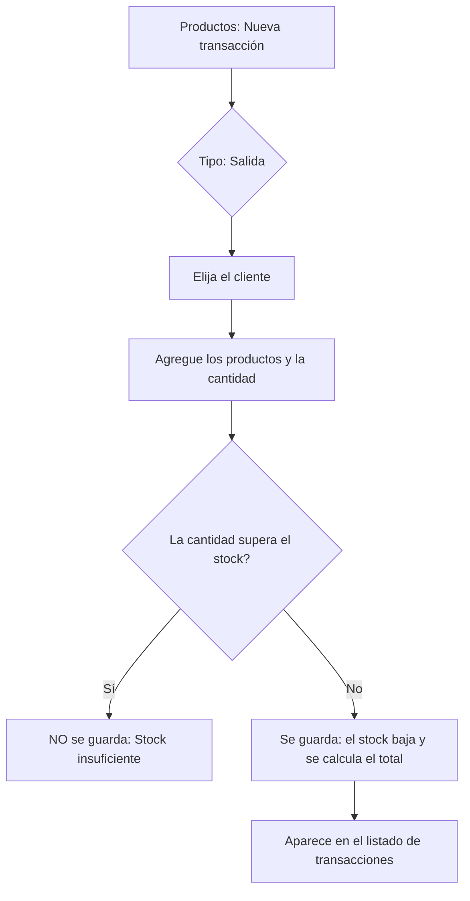
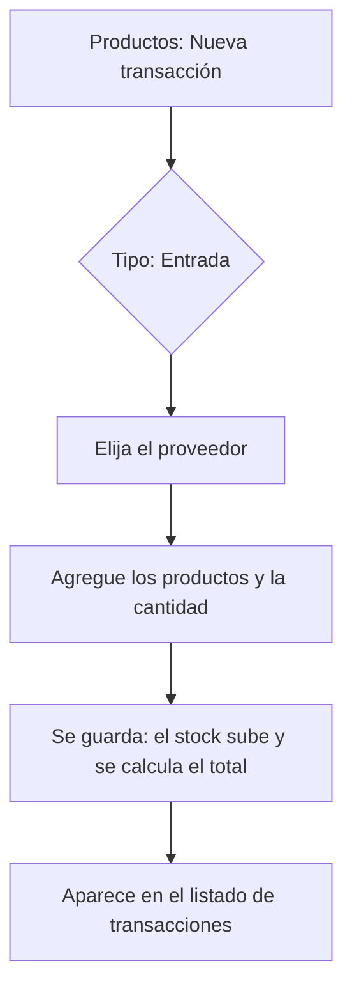

# Manual de usuario — Sistema de Inventario para PyMEs

Este manual explica, en lenguaje sencillo, cómo usar el sistema de gestión de inventarios desarrollado durante el proceso formativo. Está escrito para personas sin conocimientos técnicos: basta con seguir los pasos en el orden indicado.

## 1. ¿Qué es este sistema?

Es una aplicación web que permite administrar el inventario de una pequeña o mediana empresa desde un solo lugar. Con ella usted puede:

- Organizar sus productos en categorías.
- Controlar cuántas unidades tiene de cada producto y a cuánto las compra y las vende.
- Registrar clientes y proveedores.
- Registrar las **entradas** (compras) y **salidas** (ventas) de mercancía, actualizando el inventario automáticamente.
- Consultar y actualizar sus datos y los de su empresa.

El sistema **no muestra información de otras empresas**: cada usuario solo ve los datos de la compañía a la que pertenece.

## 2. Cómo ingresar al sistema

### 2.1 Requisitos

Solo necesita un computador con conexión a internet y un navegador actualizado (Chrome, Edge o Firefox). No se instala nada.

Al abrir la dirección del sistema aparece una **página de bienvenida** con el título *Sistema de Gestión de Inventarios*. Desde ahí puede entrar con **Iniciar Sesión** o crear su cuenta con **Crear Cuenta**.

> 📷 **CAPTURA 01** — Página de bienvenida completa, con los botones "Crear Cuenta" e "Iniciar Sesión" visibles.

### 2.2 Crear una cuenta nueva

Haga clic en **Crear Cuenta**. Se abre el formulario **"Registra un nuevo usuario"**, dividido en dos bloques.

**Sus datos personales** (todos obligatorios):

| Campo | Qué escribir |
| --- | --- |
| Nombre | Sus nombres. |
| Apellido | Sus apellidos. |
| Correo electrónico | El correo con el que ingressará al sistema. Debe ser único. |
| Contraseña | La clave de acceso. |
| Identificación | Su número de cédula o documento. |

**Datos de la Empresa** — todos obligatorios:

| Campo | Qué escribir |
| --- | --- |
| Razón Social / Nombre | Nombre o razón social de la empresa. |
| NIT | Número de Identificación Tributaria. Debe ser único en todo el sistema. |
| Correo corporativo | Correo de la empresa. |
| Teléfono | Teléfono de la empresa. |

Haga clic en **REGISTRAR**.

> **Importante:** un registro crea la empresa **y** su usuario administrador a la vez. El NIT no se puede volver a usar en otra cuenta. Al terminar el registro, el sistema lo lleva al inicio de sesión: allí ingresa con el correo y la contraseña que acaba de crear.

> 📷 **CAPTURA 02** — Formulario de registro completo, con los dos bloques visibles.

### 2.3 Iniciar sesión

En la pantalla de acceso (**"Iniciar sesion"**) escriba su **Email** y su **Password** y pulse **Entrar al Sistema**. Si los datos son correctos, entra al sistema.

> **Nota:** al entrar, la pantalla puede verse vacía a la derecha. Esto es normal: el sistema abre en la barra de módulos y usted debe elegir la sección que necesite (ver sección 3).

> 📷 **CAPTURA 03** — Pantalla de inicio de sesión con los campos diligenciados.

### 2.4 Cerrar sesión

Pulse el icono de **salida** (una flecha saliendo de una puerta), ubicado en la parte inferior de la barra lateral. El sistema lo devuelve a la pantalla de acceso.

## 3. Descripción de la pantalla principal

Al entrar, el sistema se compone de dos áreas:

- **Barra lateral izquierda:** columna de iconos que permite moverse entre los módulos. Para saber qué módulo es, **pase el cursor sobre el icono**: aparecerá su nombre.
- **Área de trabajo (derecha):** muestra la información del módulo seleccionado.

### 3.1 Los módulos del menú

| Orden | Módulo (nombre del icono) | Para qué sirve |
| --- | --- | --- |
| 1 | **Categorías** | Agrupar los productos por tipo. |
| 2 | **Productos** | Administrar el inventario: nombres, códigos, precios y existencias. |
| 3 | **Transacciones** | Registrar compras y ventas. |
| 4 | **Clientes** | Registro de las personas o empresas que le compran. |
| 5 | **Proveedores** | Registro de las personas o empresas que le venden. |
| 6 | **Configuración** | Ver y actualizar los datos de su empresa. |
| 7 | **Perfil** | Ver y actualizar sus datos personales y su contraseña. |
| 8 | **Cerrar sesión** | Salir del sistema. |

### 3.2 Elementos comunes de todas las pantallas

- **Tabla de información:** lista los registros en filas y columnas. Mientras carga, las celdas aparecen como barras grises; si no hay registros, se muestra el mensaje **"Sin registros"**.
- Botón de la esquina superior derecha (por ejemplo, **"Añadir producto"**): abre el formulario para crear un registro nuevo.
- En la columna **Acciones** de cada fila hay dos iconos: un **lápiz** (editar) y un **canasto** (eliminar). Pase el cursor sobre ellos para ver su nombre.
- Al eliminar, el registro **se borra de inmediato**, sin pedir confirmación. Verifique antes de pulsar.
- Los mensajes de error se muestran en **rojo** encima de la tabla.

> 📷 **CAPTURA 04** — Pantalla de productos, que muestra la barra lateral, la tabla completa y los botones. Repita la captura para las pantallas de clientes, proveedores y transacciones.

## 4. Categorías

Las categorías sirven para clasificar los productos (por ejemplo: "Bebidas", "Aseo del hogar").

**Columnas de la tabla:** Nombre · Descripción · Acciones

**Crear una categoría:** pulse **Añadir categoría**, escriba el nombre (obligatorio) y, si desea, una descripción. Pulse **Crear categoría**.

**Editar:** pulse el lápiz de la fila, modifique los datos y pulse **Guardar cambios**.

**Eliminar:** pulse el canasto de la fila. **No se puede eliminar una categoría que tenga productos asociados**; primero debe reasignar o eliminar esos productos.

**Regla:** no se pueden crear dos categorías con el mismo nombre dentro de la misma empresa.

> 📷 **CAPTURA 05** — Listado de categorías con dos registros y el formulario de creación abierto.

## 5. Productos

Es el módulo central del sistema.

**Columnas de la tabla:** Proveedor · Categoría · Nombre · Descripción · Código · Precio · Stock · Acciones

> **Dato útil:** cuando un producto tiene **menos de 10 unidades**, su cantidad de stock se muestra en **rojo**, como aviso de que se está agotando.

**Crear un producto:** pulse **Añadir producto** y diligencie el formulario:

| Campo | Qué escribir |
| --- | --- |
| Referencia interna | Código propio del producto (SKU). **No se puede repetir.** |
| Nombre del producto | Nombre comercial. |
| Categoría | Seleccione una de las categorías existentes. |
| Proveedor | Seleccione quién se lo suministra (opcional). |
| Descripción | Detalle del producto (opcional). |
| Stock | Cantidad inicial de unidades. |
| Precio de costo | Valor por unidad en una **compra**. |
| Precio de venta | Valor por unidad en una **venta**. |
| Estado | Activo o Inactivo. Los productos inactivos se conservan, pero no se deben usar en las transacciones. |

Pulse **Crear Producto**. Use **Cancelar** para salir sin guardar.

**Editar y eliminar:** los mismos iconos de siempre. Antes de crear un producto, la categoría debe existir.

> 📷 **CAPTURA 06** — Formulario de creación de producto con todos los campos diligenciados.

## 6. Clientes

**Columnas de la tabla:** Identificación · Nombre · Email · Teléfono · Dirección · Registrado · Acciones

**Crear un cliente:** pulse **Añadir cliente**. Todos los campos son obligatorios: **IDENTIFICACIÓN / CC**, **NOMBRE COMPLETO**, **EMAIL**, **TELÉFONO** y **DIRECCIÓN**. Pulse **Crear Cliente**.

**Editar:** pulse el lápiz de la fila, modifique lo necesario y pulse **Guardar Cambios**.

**Regla:** la identificación es única por empresa; no se pueden registrar dos clientes con la misma identificación.

> 📷 **CAPTURA 07** — Listado de clientes y formulario de creación abierto.

## 7. Proveedores

**Columnas de la tabla:** Nombre · Email · Teléfono · Acciones

**Crear un proveedor:** pulse **Añadir proveedor**. Solo el **Nombre** es obligatorio; el email, teléfono y dirección son opcionales. Pulse **Crear proveedor**.

**Editar y eliminar:** iconos de lápiz y canasto de cada fila.

> 📷 **CAPTURA 08** — Listado de proveedores y formulario de creación abierto.

## 8. Transacciones (compras y ventas)

Es donde se registra el movimiento de mercancía. **El sistema ajusta el stock automáticamente** al guardar la operación.

### 8.1 Los dos tipos de transacción

| | 📤 Salida (Venta) | 📥 Entrada (Compra) |
| --- | --- | --- |
| Qué significa | Mercancía que **sale** de la bodega | Mercancía que **entra** a la bodega |
| Requiere | Un **cliente** | Un **proveedor** |
| Efecto en el stock | **Disminuye** | **Aumenta** |
| Precio que se usa | El **precio de venta** del producto | El **precio de costo** del producto |

El **total** de la transacción es siempre la suma de los valores de los productos, calculada con los precios del propio producto. Usted **no escribe los precios**.

### 8.2 Registrar una venta

### 8.3 Registrar una compra

### 8.4 Cómo llenar el formulario

1. Pulse **Nueva transacción**.
2. En **TIPO** elija **Salida** (venta) o **Entrada** (compra).
3. En **CLIENTE** elija el cliente (para ventas). En **PROVEEDOR** elija el proveedor (para compras).
4. En **PRODUCTOS**, pulse **+ Agregar** por cada artículo. En cada fila seleccione el producto y escriba la cantidad.
5. Si agregó una fila de más, pulse el icono **❌** para quitarla.
6. Pulse **Crear**.

> **El botón "Crear" permanece inactivo (gris) hasta que haya al menos una fila completa.** Al guardar, el sistema lo devuelve al listado de transacciones.

### 8.5 Consultar y eliminar transacciones

**Columnas de la tabla:** Tipo · Cliente · Proveedor · Usuario · Total · Fecha · Acciones. Las transacciones se muestran **de la más reciente a la más antigua**.

Para corregir una transacción equivocada, **no se edita**: se elimina y se vuelve a registrar. Al eliminar, el sistema **revierte el efecto sobre el stock**: los productos de una venta vuelven a la bodega y los de una compra salen de ella.

> **Atención:** no se puede eliminar una compra si con ella el producto quedaría con existencias negativas (porque ya se vendió). En ese caso, primero registre una venta por esas unidades y luego elimine la compra.

> 📷 **CAPTURA 09** — Formulario de creación de una venta con dos filas de productos. **CAPTURA 10** — Listado de transacciones mostrando una entrada y una salida.

## 9. Mi Perfil

Pulse el icono de **Perfil** (persona dentro de un círculo).

En la parte izquierda aparecen sus datos actuales: nombre completo, número de identificación, correo y rol. En la parte derecha hay dos formularios:

- **EDITAR INFORMACIÓN PERSONAL:** cambia sus **Nombres**, **Apellido** o **Correo electrónico**, y pulse **Guardar cambios**. El correo no puede ser uno que ya use otra cuenta.
- **CAMBIAR CONTRASEÑA:** escriba la **Contraseña actual**, la **Nueva contraseña** (mínimo 8 caracteres) y luego **Confirmar contraseña**. Si las dos nuevas no coinciden, el sistema avisa con el mensaje *"Las contraseñas no coinciden"*. Pulse **Cambiar contraseña**; al completarse, los campos quedan limpíos.

> 📷 **CAPTURA 11** — Pantalla "MI PERFIL" con los dos formularios visibles.

## 10. Mi Compañía

Pulse el icono de **Configuración** (rayo). En la parte izquierda se muestran, en solo lectura, la razón social, el NIT, el correo y el teléfono. En la parte derecha puede actualizar el **Nombre de la empresa**, el **Correo electrónico** y el **Teléfono**, y luego pulsar **Guardar cambios**.

El **NIT no se puede modificar**: es el identificador legal de la empresa. Esta sección solo la puede editar el administrador de la cuenta; si aparece un mensaje indicando lo contrario, solicite el cambio al administrador.

> 📷 **CAPTURA 12** — Pantalla "MI COMPAÑÍA" con el formulario de edición.

## 11. Mensajes frecuentes y cómo resolverlos

Si un formulario no se guarda, revise la información. Los mensajes más comunes son:

| Mensaje | Qué ocurrió | Qué hacer |
| --- | --- | --- |
| Ya existe un cliente con la identificación... | La identificación ya está registrada en su empresa. | Edite el cliente existente o use otra identificación. |
| Ya existe una categoría llamada... | Ya hay una categoría con ese nombre. | Escriba un nombre diferente. |
| Ya existe un producto con la referencia... | Esa referencia interna ya está en uso. | Escriba otro código de referencia. |
| Stock insuficiente para [producto] | Quiere vender más unidades de las que hay. | Reduzca la cantidad o registre primero una compra. |
| Las ventas requieren un cliente | Registró una venta sin seleccionar cliente. | Elija el cliente y guarde de nuevo. |
| Las compras requieren un proveedor | Registró una compra sin seleccionar proveedor. | Elija el proveedor y guarde de nuevo. |
| No se puede eliminar: hay productos asociados a esta categoría. | La categoría tiene productos. | Cambie de categoría o elimine esos productos primero. |
| No se puede eliminar la transacción porque [producto] quedaría con stock negativo. | Ya se vendió parte de esa compra. | Registre una venta por esas unidades y luego elimine la compra. |
| La nueva contraseña debe tener al menos 8 caracteres | Contraseña muy corta. | Escriba una contraseña de 8 caracteres o más. |
| La contraseña actual es incorrecta | No coincidió con la que tiene registrada. | Revise e vuelva a escribirla. |
| El email ya está en uso | Ese correo ya tiene una cuenta. | Use otro correo. |
| El NIT de la compañía ya existe | Ya hay una empresa registrada con ese NIT. | Verifique el NIT o comuníquese con el administrador del sistema. |

## 12. Alcance de esta versión

Para evitar confusiones, esta versión **no incluye** las siguientes funciones:

- Panel con estadísticas, gráficos ni reportes exportables.
- Búsqueda de texto, filtros, ordenamiento ni paginación en los listados.
- Gestión de usuarios del equipo y asignación de roles desde la aplicación: hoy solo existe el usuario administrador que creó la cuenta.
- Edición de una transacción ya guardada (se corrige eliminándola y volviéndola a registrar).
- Confirmación antes de eliminar: el borrado es inmediato.
- Cambio del NIT y de la identificación del usuario.

> **A tener en cuenta:** cada cuenta creada representa una única empresa.

## 13. Lista de capturas de pantalla pendientes

Antes de entregar el manual, reemplace cada bloque 📷 por la captura correspondiente. Se recomienda usar datos de ejemplo y ocultar datos reales.

| N.º | Pantalla | Qué debe verse |
| --- | --- | --- |
| 01 | Página de bienvenida | Título del sistema y botones "Crear Cuenta" / "Iniciar Sesión". |
| 02 | Registro de usuario | Formulario completo con los bloques personal y de empresa. |
| 03 | Inicio de sesión | Campos de correo y contraseña diligenciados. |
| 04 | Pantalla de productos | Barra lateral, botones de filtrado, tabla con datos y columna de acciones. |
| 05 | Categorías | Listado con registros y formulario de creación. |
| 06 | Formulario de producto | Todos los campos diligenciados, incluida la categoría seleccionada. |
| 07 | Clientes | Listado y formulario de creación. |
| 08 | Proveedores | Listado y formulario de creación. |
| 09 | Formulario de transacción | Tipo "Salida", cliente elegido y dos filas de productos. |
| 10 | Listado de transacciones | Una entrada y una salida con su total y fecha. |
| 11 | Mi Perfil | Datos personales y los formularios de información y contraseña. |
| 12 | Mi Compañía | Datos de la empresa y formulario de edición. |
